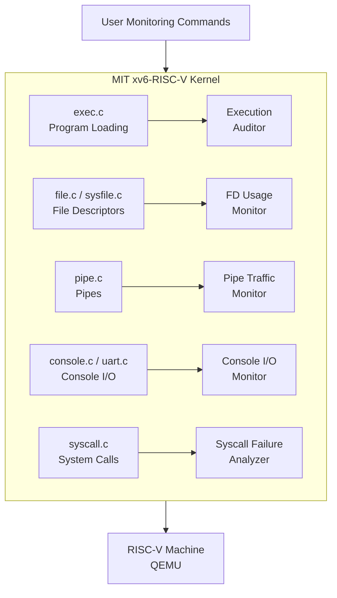
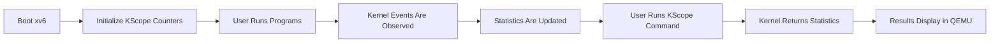

# # KScope — Kernel I/O & Execution Audit Extensions for xv6-RISC-V

> **Operating Systems Project Proposal**  
> **Student:** Ibraheem  
> Base Kernel: **MIT xv6-RISC-V**

---

## Project Overview

**KScope** is an Operating Systems project based on the official **MIT xv6-RISC-V kernel**.

The project will extend xv6 with **5 proposed custom kernel modules** focused on program execution, file-descriptor usage, pipes, console I/O, and failed kernel requests.

The main goal is to keep the original xv6 design unchanged while adding small monitoring hooks that are easy to implement, test, demonstrate, and explain.

---

## Proposed 5 Modules

### 1. Program Execution Auditor
Tracks program execution through `exec()`, including successful and failed executions, loaded programs, and basic executable-loading statistics.

### 2. File Descriptor Usage Monitor
Tracks open file descriptors, file allocation/close activity, and peak file-descriptor usage so resource usage can be inspected.

### 3. Pipe Traffic Monitor
Tracks pipe creation and basic pipe activity such as bytes written, bytes read, and active pipe usage.

### 4. Console I/O Activity Monitor
Tracks basic terminal activity such as console input, console output, and UART-related I/O events.

### 5. System Call Failure Analyzer
Counts failed system-call requests and identifies which system calls are producing errors most frequently.

---

## System Architecture



---

## Working Flow



---

## Final Goal

```text
MIT xv6-RISC-V
      +
5 Custom Audit & I/O Modules
      =
KScope Enhanced xv6 Kernel
```

The project is intended to remain simple enough to understand and demonstrate while still being different from common xv6 scheduler, virtual-memory, and file-system modification projects.

---

## Current Status

**Status:** Project Selection / Planning Stage  
**Implementation:** Not started yet  
**Next Step:** Run the original xv6 kernel and then implement each KScope module one by one.